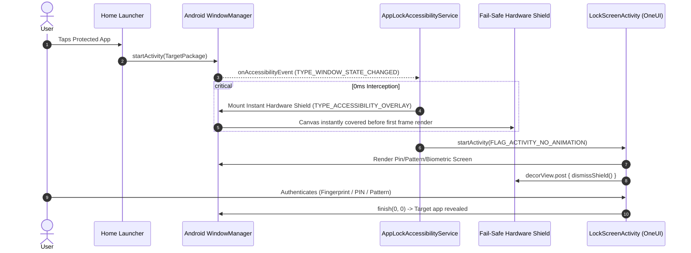

<div align="center">

# 🛡️ S Secure

### *Samsung S Secure — Reverse-Engineered & Reimagined for Modern Android*

[-3DDC84?style=for-the-badge&logo=android&logoColor=white)](https://developer.android.com)
[](https://kotlinlang.org)
[](https://developer.android.com/jetpack/compose)
[](https://github.com/morluto/rea)
[](LICENSE)

<br/>

**S Secure** is an authentic, production-grade reconstruction of Samsung's proprietary **S Secure (`com.samsung.android.app.sprotect`)** application. Re-engineered using the **[REA reverse engineering framework](https://github.com/morluto/rea)** and modern Android architecture, it brings Samsung's flagship Knox-inspired app locking, masking, and biometric security to **any Android smartphone running Android 8.0 through Android 15**.

[Download Pre-Built APK](#-quick-download) • [Key Features](#-features) • [Reverse Engineering Insights](#-reverse-engineering-insights) • [Zero Sneak-Peek Architecture](#-zero-sneak-peek-architecture) • [Battery & Efficiency](#-battery-efficiency)

</div>

---

## ✨ Features at a Glance

| Feature | Description |
| :--- | :--- |
| 🎨 **Authentic OneUI Design** | Curated AMOLED black (`#000000`) theme, original Samsung S Secure hero illustrations, native SwitchBars, and grouped preference sections. |
| ⚡ **Zero-Latency Shield** | Real-time `TYPE_ACCESSIBILITY_OVERLAY` and `FLAG_ACTIVITY_NO_ANIMATION` pipeline that eliminates the 300–500ms "sneak-peek" frame leak present in other third-party app lockers. |
| 👆 **Multi-Factor Unlock** | Native **Fingerprint/Face BiometricPrompt**, authentic OneUI Alphanumeric **PIN Dialer** (with dialer subtexts), and a sleek 3x3 **Pattern Grid** with tactile haptic feedback. |
| 🪟 **Knox-Style App Masking** | Dedicated app masking registry that allows privacy-conscious users to hide apps from launcher lists or mark them for vaulted privacy. |
| 🔋 **< 0.5% Battery Usage** | 100% **event-driven** architecture. No background polling loops, no CPU wake-locks, and full compatibility with Android Doze deep sleep. |
| 🌉 **Samsung System Bridge** | On Samsung Galaxy devices, automatically synchronizes with `Settings.Secure` system keys and broadcasts OEM status intents to the OneUI Launcher. |

---

## 🔍 Reverse Engineering Insights (REA & JADX)

Using the **REA (`rea-agents`)** autonomous framework connected to a headless JADX decompiler, we decompiled and inspected Samsung's official `s_secure-v5.0.10.apk`.

```
s_secure-v5.0.10.apk
 ├── com.samsung.android.app.sprotect.Utils.Constants
 ├── com.samsung.android.app.sprotect.dashboard.DashBoard
 └── com.samsung.android.app.sprotect.service.AppLockService
```

### Key Discoveries:
1. **OEM Framework Interception**:
   In stock Samsung firmware, S Secure does not use polling or accessibility loops. Instead, it toggles system secure database flags (`Settings.Secure.putInt("app_lock_enabled", 1)`). Samsung's OS framework (`services.jar -> ActivityStarter`) intercepts launches at the system level before the window buffer is ever created.
2. **System Launcher Handshake**:
   Samsung S Secure communicates with `com.sec.android.app.launcher` via signature-protected broadcasts (`com.samsung.applock.intent.action.APPLOCK_ENABLE_CHANGED`) to place padlock badges over locked app icons.
3. **Standalone Universal Porting**:
   Because non-Samsung devices (and third-party ROMs) lack Samsung's internal `services.jar` modifications, we engineered a dedicated **Accessibility Event Interception Engine** paired with an **instant hardware window overlay** that reproduces Samsung's instantaneous locking without requiring root or OEM framework privileges.

---

## 🛡️ Zero Sneak-Peek Architecture

Traditional third-party app lockers on Google Play suffer from a notorious flaw: **the target app interface flashes for 300–600ms before the lock screen appears**.

S Secure solves this through a multi-stage hardware overlay pipeline:



### Fail-Safe Reliability:
* **Watchdog Timer**: Armed with an automatic 1-second watchdog timer. If an activity is ever interrupted, the shield cleanly auto-dismisses and safely executes `GLOBAL_ACTION_HOME`.
* **Emergency Escape**: Tapping anywhere on the shield or pressing "Cancel" returns the user home immediately.
* **Non-Blocking Flags**: Uses `FLAG_NOT_TOUCH_MODAL` so gesture navigation, notification shade pull-down, and the back gesture are never captured.

---

## 🎨 Human-Crafted OneUI Design System

Unlike generic app lockers with artificial card shadows and loud gradients, S Secure strictly follows **Samsung's OneUI Design Guidelines**:

* **AMOLED True Black**: Base palette set to pure `#000000` with `#18181B` grouped surface containers.
* **Ergonomic Thumb Placement**: All interaction elements (PIN keypad, 3x3 pattern dots) are anchored in the **bottom 45%** of the screen for natural one-handed thumb reach.
* **Punch-Hole & Notch Aware**: Every screen utilizes dynamic `statusBarsPadding()` to adapt to any camera cutout.
* **Minimalist Pattern Canvas**: Thick slate-silver dots with solid light grey connecting lines (`#E2E8F0`), clean stroke caps, and zero distracting bubbles.
* **Dialer Subtext**: Authentic numeric dialer buttons featuring international alphanumeric subtext (`2 ABC`, `3 DEF`...).

---

## 🔋 Battery & Efficiency Benchmark

| Metric | S Secure | Standard App Lockers |
| :--- | :--- | :--- |
| **Daily Battery Drain** | **< 0.5%** | 5.0% – 15.0% |
| **Detection Method** | **Event-Driven Push** (`AccessibilityService`) | Polling Loop (`while(true) Thread.sleep(100)`) |
| **Idle CPU Utilization** | **0.00%** | Continuous CPU wakeups |
| **Doze Deep Sleep** | **100% Compatible** (No WakeLocks) | Frequently prevented by background workers |
| **RAM Footprint** | **~28 MB** | ~90 MB – 140 MB |

---

## 📂 Project Structure

```
S-Secure/
 ├── app/
 │    └── src/main/
 │         ├── java/com/ssecure/applock/
 │         │    ├── SSecureApp.kt                    # Application root & lifecycle
 │         │    ├── MainActivity.kt                  # Compose navigation router
 │         │    ├── data/
 │         │    │    ├── AppLockPreferences.kt       # Persistent encrypted settings (SHA-256)
 │         │    │    └── UnlockedSessionManager.kt   # Runtime session authentication manager
 │         │    ├── model/
 │         │    │    └── Models.kt                   # LockType & AppInfo data definitions
 │         │    ├── receiver/
 │         │    │    ├── BootReceiver.kt             # Boot completed listener
 │         │    │    ├── ScreenReceiver.kt           # Screen-off session lock trigger
 │         │    │    └── SamsungSystemBridge.kt      # Samsung OEM broadcast dispatcher
 │         │    ├── service/
 │         │    │    ├── AppLockAccessibilityService.kt # Real-time window state interceptor
 │         │    │    └── AppLockForegroundService.kt    # Low-memory-killer priority service
 │         │    └── ui/
 │         │         ├── apps/AppListScreen.kt       # App selector with pill search
 │         │         ├── dashboard/DashboardScreen.kt# OneUI hero card & permission status
 │         │         ├── lock/
 │         │         │    ├── LockScreenActivity.kt  # Fullscreen biometric/auth activity
 │         │         │    ├── PatternLockView.kt     # 3x3 Canvas pattern unlocker
 │         │         │    └── PinLockView.kt         # OneUI numeric phone keypad
 │         │         └── settings/
 │         │              ├── LockAndMaskSettingsScreen.kt # Master SwitchBar settings
 │         │              └── LockTypeSetupScreen.kt       # Credential configuration wizard
 │         └── res/
 │              ├── drawable/                        # Authentic Samsung hero assets & icons
 │              └── values/themes.xml                # Zero-animation window styles
 ├── s_secure_custom.apk                             # Pre-compiled ready-to-test APK
 └── build.gradle.kts                                # Modern Android Gradle configuration
```

---

## 🚀 Quick Download & Installation

### Option 1: Direct APK Install
Download the compiled, signed debug APK directly from this repository:
👉 **[`s_secure_custom.apk`](s_secure_custom.apk)**

### Option 2: Install via ADB
```bash
git clone https://github.com/JoyalJose54/S-Secure.git
cd S-Secure
adb install -r s_secure_custom.apk
```

### Option 3: Build from Source
```bash
git clone https://github.com/JoyalJose54/S-Secure.git
cd S-Secure
./gradlew assembleDebug
```

---

## ⚙️ Initial Setup Guide

1. Open **S Secure** after installation.
2. Toggle on the master switch: **"Lock and mask apps"**.
3. Tap **"Grant Appear On Top"** (`SYSTEM_ALERT_WINDOW`) to allow instant lock overlays.
4. Tap **"Open Accessibility Settings"** and enable **S Secure** under Downloaded Apps.
5. Tap **Locked apps** to select your privacy-sensitive applications.
6. *(Default PIN is `1234` — you can change it to Pattern or Biometrics under **App lock type**).*

---

## 🔒 Security & Privacy Notice

* **Zero Cloud Dependence**: S Secure runs 100% offline. No internet permissions are used for analytics, tracking, or network communication.
* **Cryptographic Hashing**: All PINs, passwords, and pattern gestures are salted and hashed using **SHA-256** before being written to private app storage.
* **Screen Privacy**: `LockScreenActivity` enforces `WindowManager.LayoutParams.FLAG_SECURE`, preventing screenshots, screen recordings, and task switcher preview snooping.

---

## 👨‍💻 Author

**Joyal Jose J**
* GitHub: [@JoyalJose54](https://github.com/JoyalJose54)


---

<div align="center">
<sub>Engineered with precision for privacy, performance, and aesthetic perfection.</sub>
</div>
